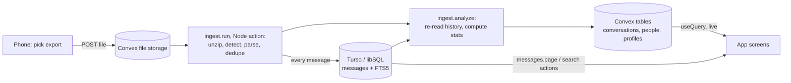

# @textrovert/history

The chat history data layer: parsers for 10 platforms, a Turso message store that keeps every message, the analyzer,
and the Convex backend that runs them. It is its own Convex project, separate from `packages/backend`.

Users upload the chat exports they already have (a zip or single file from WhatsApp, iMessage, Instagram, Messenger,
Snapchat, Discord, Telegram, ChatGPT, Claude, or a CSV). The backend detects what each file is, parses it into one
normalized shape, keeps **every** message, and turns the history into stats the app renders live.



## Where data lives

| What | Where | Why |
| --- | --- | --- |
| Raw upload | Convex file storage | Deleted as soon as processing ends (done or failed). |
| Every message | Turso (`pipeline/store.ts`): `messages` table + FTS5 index, partitioned by a hash of the owner key | Full history can be millions of rows; Convex's free tier caps the database at 0.5 GB. |
| Per-chat stats, people, profile insights, upload status | Convex (`convex/schema.ts`) | Small, reactive: screens update live while an upload is processed. |

The app never talks to Turso. Message pages and search go through Convex actions (`convex/messages.ts`), so the
Turso token stays on the server.

Messages get a deterministic id from (platform, chat, time, sender, text), so uploading the same export twice, or an
overlapping newer export, only adds the messages that are new. Stats are always recomputed from the stored history,
never from one upload alone.

## Using it from the app

`client/chatData.ts` has the client plumbing (copy it into the Expo app and point its `_generated` import at this
package; it needs `expo-document-picker`, `expo-file-system`, and `expo-secure-store`, all in Expo Go). Everything else
is regular Convex calls against this package's `convex/_generated/api`.

```ts
const { ownerKey } = useOwnerKey(); // per-device key, minted on first launch, kept in SecureStore
const convex = useConvex();

// Upload: opens the file picker, uploads each file, starts processing. Returns upload ids.
const uploadIds = await pickAndUploadExports(convex, ownerKey, { selfName: "Kevin" /* optional */ });

// Live progress: status is queued → parsing → analyzing → done | failed (with `error`).
const upload = useQuery(api.uploads.get, ownerKey ? { ownerKey, uploadId } : "skip");

// Wrapped-style profile stats (null until the first upload finishes).
const profile = useQuery(api.insights.get, ownerKey ? { ownerKey } : "skip");

// Chats and people, paginated. sort: "recent" | "messages" | "closeness"; optional platform filter.
const chats = usePaginatedQuery(api.conversations.list, ownerKey ? { ownerKey, sort: "closeness" } : "skip", { initialNumItems: 30 });
const people = usePaginatedQuery(api.people.list, ownerKey ? { ownerKey } : "skip", { initialNumItems: 30 });
const chat = useQuery(api.conversations.get, { ownerKey, conversationId }); // full stats for one chat
const person = useQuery(api.people.get, { ownerKey, personId }); // one person + their chats

// Full message history (actions, not live queries).
const { messages, nextCursor } = await convex.action(api.messages.page, { ownerKey, conversationId, cursor, limit: 50 });
const hits = await convex.action(api.messages.search, { ownerKey, query: "pizza" }); // snippet marks matches with **
const context = await convex.action(api.messages.around, { ownerKey, conversationId, messageId: hit.id, ts: hit.ts });

// Wipe everything (Turso rows, Convex rows, files).
await convex.action(api.account.deleteAllData, { ownerKey });
```

### What the stats contain

- **Profile insights** (`insights.get`): totals (sent, received, chats, people, first and last message), messages per
  platform, a 7×24 heatmap of when you text (index `weekday * 24 + hour`, Sunday = 0, in the phone's time zone),
  monthly sent/received, your vs. their reply-time medians and histograms, habits (who starts conversations, double
  texts, night-owl share, words per message, laughs, questions, emojis), top emojis and words, top people, archetype
  badges with a reason line ("Night Owl: 21% of your texts go out between midnight and 5am"), and AI usage (prompts,
  prompts per month).
- **Per chat** (`conversations.get` → `stats`): message counts, first/last message, active days, longest streak and
  gap, sessions, per-participant breakdown (messages, words, media, emojis, laughs, questions, who starts and who has
  the last word, double texts, reply-time medians), hourly/weekday/heatmap, monthly volume, top words and emojis,
  links, calls, and AI prompt stats for ChatGPT/Claude chats. `closeness` is a 0-100 score from volume, balance,
  recency, and consistency.
- **People** (`people.list`): everyone you talk to, merged across platforms by name, ranked by closeness.

### Who is "me"?

Exports often don't say which sender is the user. The pipeline works it out from profile files (Instagram,
Messenger, Telegram), chat titles (a WhatsApp DM is named after the other person), names learned from earlier
uploads, and the participant present in nearly every chat. A chat it can't resolve has `selfName: null`; pass
`selfName` when uploading (for example, ask "what's your name in your chats?") to settle it.

## Matching: what two people have in common

Two users who have each uploaded their history can compare them. One creates an invite and sends the code; the other
joins with it. Each person's interests are built only from messages they sent themselves, and neither person ever sees
the other's messages or full profile: a match shows only the overlap, with the things that never came up between the
two of them first.

```ts
// Kevin: start a match. His interest profile starts building right away.
const { matchId, code } = await convex.mutation(api.matches.create, { ownerKey, name: "Kevin" }); // code: "MZP62X"
// Emma: join with the code Kevin sent her (case-insensitive).
const matchId = await convex.mutation(api.matches.join, { ownerKey, code, name: "Emma" });

// Either of them, live: status is waiting → analyzing → comparing → ready | failed (with `error`).
const match = useQuery(api.matches.get, { ownerKey, matchId });
// match.you / match.them: { name, state } where state is uploading | needs_upload | analyzing | ready | failed.
// match.result.items, things that never came up between you (hidden: true) first:
//   { title, category, match: "same" | "activity" | "related", hidden, betweenYou, starter,
//     you: { detail, mentions, since }, them: { detail, mentions, since } }
// match.result.sharedChats: how many of your chats the other person is in (your DM and shared groups).

const matches = useQuery(api.matches.list, { ownerKey }); // [{ _id, them, status, shared, hidden, ... }]
await convex.mutation(api.matches.rerun, { ownerKey, matchId }); // retry after a failure
await convex.mutation(api.matches.remove, { ownerKey, matchId }); // deletes it for both people

const mine = useQuery(api.interests.mine, { ownerKey }); // your own interest profile, strongest first
```

How it works:

- **Interest profiles** (`pipeline/interests.ts`): the model reads the texts you sent to people (not AI chats, not what
  others sent you) in batches and lists interests. Words you use rarely but keep coming back to are grouped and read
  first, so a hobby mentioned 50 times in 60,000 texts isn't lost among the small talk. Everyday routines (running late,
  plans, Venmo) and private topics (health, sexuality, dating, religion, politics, money, legal trouble, drugs) are
  flagged by the model and dropped in code. Every interest is then checked against your whole history: one that fewer
  than 3 of your messages mention is dropped, and the counts and first-mention dates come from that check. Histories
  over about 1.6M characters of your own texts are read as an even sample, but the check still covers every message.
- **The comparison** (`pipeline/commonGround.ts`) sees only the two profiles, never messages. It names each overlap and
  whether it's the same thing, the same activity, or just related.
- **"Didn't know" vs. "already talked about"**: the two people's chats with each other are found without names or
  numbers, by texts one sent that show up among the other's received texts within 5 minutes. An overlap that came up
  fewer than 3 times in those chats is `hidden`.
- A profile is rebuilt after each new upload, and every match the person is in re-runs with it.

It needs an OpenAI key on the deployment (`npx convex env set OPENAI_API_KEY <key>`; `OPENAI_MODEL` overrides the
default `gpt-5-mini`). Building a profile takes about 30 seconds for a few hundred sent texts and 2 to 3 minutes for 60,000 (longer when
OpenAI is slow).
To try it without Convex, `OPENAI_API_KEY=... pnpm common-ground --a kevin/chat.db --b emma/chat.db --tz America/Los_Angeles`
prints both profiles and the comparison.

## Getting exports (what to tell users)

| App | How | Upload |
| --- | --- | --- |
| WhatsApp | Chat → ⋯ → Export chat → **Without media** | the .zip or .txt |
| Instagram | Accounts Center → Your information → Download → Messages only, **JSON** | the .zip |
| Messenger / Facebook | Same flow, Messages, **JSON** (end-to-end encrypted chats export separately as JSON) | the .zip |
| Telegram | Desktop app → Settings → Advanced → Export Telegram data, **JSON** | result.json or the zip |
| Snapchat | Settings → My Data → include Chat History, **JSON** | the .zip |
| Discord | Settings → Data & Privacy → Request data | the package .zip |
| ChatGPT | Settings → Data controls → Export | the .zip |
| Claude | Settings → Privacy → Export data | the .zip |
| iMessage | On a Mac: the Textrovert Mac app in `mac/` exports it with imessage-exporter and uploads it. Or copy `~/Library/Messages/chat.db` | done by the Mac app, or chat.db |
| Anything else | CSV with date, sender, and text columns | the .csv |

Several platforms can go in one zip, or be uploaded one after another; it all merges.

## Setup

```sh
pnpm install                 # from the repo root
cd packages/history
npx convex dev               # pick or create the Convex project; writes .env.local
```

This code is live on Kevin's dev deployment `wry-bandicoot-379` (project consumer-mobile-hack), which already has the
Turso variables set; use that project to keep the data. On a new deployment, the message store needs a Turso database
(a regular libSQL one, not the preview engine, in AWS us-east-1 next to Convex; the free tier holds 5 GB):

```sh
npx convex env set TURSO_DATABASE_URL libsql://<db>-<org>.turso.io
npx convex env set TURSO_AUTH_TOKEN <token>
```

Tables and the search index are created on first use. If the database has no FTS5 support, search falls back to
substring matching instead of failing.

Local development needs no Turso or Convex: `pnpm analyze ~/Downloads/export.zip --tz America/Los_Angeles`
runs the whole pipeline against a SQLite file in `.data/` and prints the insights (`--json` for the raw output,
`--me "Your Name"` to say who you are). `pnpm test` runs the parser, store, analyzer, and end-to-end tests; `pnpm typecheck` checks the pipeline and Convex code.

## Local Ask API (dev only)

`scripts/ask-server.ts` runs the assistant (`pipeline/assistant`) over a local message database so an app can try Ask
against real chats without Convex. It binds 127.0.0.1 only, sends CORS headers, and opens the database on one
connection with `busy_timeout` and `query_only`, so it never writes. Nothing about the data is hardcoded; it reads:

| Variable | Meaning |
| --- | --- |
| `ASK_DB` | Path to the libSQL/SQLite file (messages, chunks, episodes, facts). |
| `ASK_OWNER` | Store owner of the rows. |
| `ASK_CONVERSATIONS` | JSON array of `ConversationRef` (the chat directory the assistant scopes to). |
| `ASK_ENV_FILE` or `OPENAI_API_KEY` | A file containing `OPENAI_API_KEY=...`, or the key itself. |
| `ASK_TZ` | Owner's IANA time zone (defaults to this machine's). |
| `ASK_PORT`, `ASSISTANT_MODEL` | Optional: port (8787) and chat model override. |

```sh
ASK_DB=.data/my.db ASK_OWNER=local ASK_CONVERSATIONS=.data/my-refs.json ASK_ENV_FILE=../ingest/.env \
ASK_TZ=America/Los_Angeles pnpm ask-server
```

It exits with a message naming the missing variable or file. Endpoints (all dates are ISO 8601 strings):

- `GET /people` → `{"people": [{"name", "dm", "chats", "messages", "lastAt"}]}`, people with a DM first, by message count.
- `POST /ask` with `{"question", "person"?, "history"?: [{"role": "user" | "assistant", "content"}]}` →
  `{"answer", "person", "chats", "citations": [{"n", "messageId", "sender", "fromMe", "chat", "chatId", "sentAt", "text", "quote"}]}`.
  `answer` carries inline `[n]` markers; each citation's `text` is the full original message and `quote` the exact
  span the answer relies on. `person` scopes the assistant to the chats that person is in (their DM and shared groups).
  Errors are `{"error"}` with a 4xx/5xx status.
- `POST /wrapped` with `{"conversationId", "from"?: "YYYY-MM-DD", "through"?: "YYYY-MM-DD", "model"?: true,
  "avoiding"?: [messageId], "number"?, "includeWarmMoments"?, "allowAffectionateTeasing"?, "timeoutMs"?, "debug"?}` →
  `{"conversation", "range", "outcome", "wider", "model"}`: one Wrapped edition (`@textrovert/wrapped`) for a DM over whole
  days in `ASK_TZ`. Without `from`/`through` the range is the 30 days ending on the chat's last message. `conversation`
  is the chat's id, service, participants, title and kind (no messages). Message ids are the store's ids and the owner's
  messages carry participant id `owner`. `outcome` is the package's `WrappedOutcome` as JSON (instants in epoch ms), with
  every quote already resolved against the rows; groups get `{"kind": "empty", "reason": {"kind": "unsupportedConversation"}}`.
  `wider` is the next wider range around `range`, clamped to the chat (null when there's nothing outside it). With `model`
  (default on) the eligible messages go to OpenAI (`WRAPPED_MODEL`, default gpt-5-mini) and its picks pass the same gate;
  `"model": false` is rules only. Pass the previous editions' source ids as `avoiding` for "Another edition".
- `GET /health` → `{"ok": true, "chats"}`.

Every /ask citation also carries `isDm` (the chat is the user's one-to-one DM) and `before`/`after`: up to two
messages on each side of it in the same chat, `[{"sender", "fromMe", "sentAt", "text"}]`, oldest first.

Friends, memoirs, the portrait and reels (`friendRoute` in `pipeline/assistant/api.ts`; both servers). A *source* is
`{"messageId", "sender", "fromMe", "sentAt", "text", "chat", "chatId", "isDm"}`:

- `GET /friend?name=` → `{"person", "chats": [{"id", "title", "platform", "isDm", "messageCount", "lastAt"}],
  "dmConversationId", "facts": [{"predicate", "object", "quote", "messageId", "validFrom", "validTo", "source"}],
  "plans": [{"what", "date", "when", "who", "episodeId", "source"}], "episodes": [{"id", "title", "summary", "mood",
  "kind", "topics", "chatId", "chat", "isDm", "start", "end", "messageCount", "source"}], "topics": [{"topic",
  "count"}], "story", "stats"}`. Facts come from the person's own chats (health facts are never returned), plans from their
  DM or naming them in a group, episodes and topics from their DM and the group episodes they're in. `story` is the
  cached memoir or null. `stats` is `{"person", "dm"}` from `pipeline/analyze.ts` over just their chats: `person` is
  their merged `Person` (messages each way, who starts conversations, reply medians, closeness) and `dm` the DM's
  breakdown (hourly, weekday, monthly, streak, top words and emoji, reply medians, initiations), or null without a
  DM. 404 for an unknown name.
- `GET /story?name=&refresh=1` → `{"story": {"headline", "chapters": [{"title", "period", "sentences": [{"n", "text",
  "refs", "episodes": [{"id", "title", "summary"}]}]}], "sources": {"<messageId>": source}, "writtenAt"} | null}`.
  Written on first request (about 10 seconds) by the portrait's memoir writer with its footnote check (every ref is a
  message in a chat with that person; sentences without one are dropped), then cached in the `portrait_cache` table.
  `n` numbers the footnotes through the memoir. 503 without an OpenAI key.
- `GET /portrait` → the portrait (`pipeline/portrait/types.ts`, what `packages/portrait` renders) with every cached
  memoir, cached until a new message, episode or memoir arrives.
- `GET /stats` → `{"insights", "people"}`: `buildInsights` and `buildPeople` (`pipeline/insights.ts`) over every chat,
  the same numbers Convex stores per profile (totals, heatmap, monthly, reply times, habits, top emoji and words,
  archetypes), plus the 30 closest people. Times are milliseconds. Computed on first request and kept until a new
  message arrives.
- `GET /today` → `{"replies": [{"person", "message": source}], "plans": [{"what", "date", "when", "who", "episodeId",
  "person", "source"}]}`: DMs whose last message is theirs (within 14 days), most recent first, and plans from any chat
  dated on or after today (undated ones from the last 7 days), soonest first; 10 of each. Windows count back from the
  newest message, so an older export still shows what was open when it was taken.
- `POST /reel {"episodeId"}` and `GET /reel?episodeId=` → `{"status": "none" | "rendering" | "ready" | "failed" |
  "unavailable", "episodeId", "url"?, "error"?, "message"?}`. The local server renders with `packages/reels`
  (episode-props, then render; about a minute, one at a time) into `packages/reels/.data/app/` and serves
  `GET /reels/<id>.mp4` with byte ranges. The hosted API always answers `unavailable` ("Reels render on the desktop
  app"). `ASK_REELS=0` turns rendering off locally.

The local server never writes to `ASK_DB`: memoirs and the portrait are cached in `ASK_CACHE_DB` (default
`.data/ask-cache.db`).

The request parsing, people list, person scoping and citation mapping live in `pipeline/assistant/api.ts`, and the
`/wrapped` handler in `pipeline/assistant/wrappedApi.ts`, both shared with the hosted API below, so both servers answer
identically.

## Hosted API

`convex/http.ts` serves the phone app from the deployment's site URL (`https://<deployment>.convex.site`, team
deployment `https://wry-bandicoot-379.convex.site`), with CORS. Every route but `/health` needs `x-api-key` equal to
the deployment's `ASK_API_KEY` (401 otherwise, 503 while unset); the app sends it from `EXPO_PUBLIC_API_KEY`.

**Owner.** Send `x-owner-key: <ownerKey>` (from `POST /account`, kept in SecureStore) to act as that user. Read routes
(`/ask`, `/people`, `/status`, `/wrapped`, `/friend`, `/story`, `/portrait`, `/stats`, `/today`, `/reel`) fall back to the demo owner `ASK_OWNER_KEY` when the header is missing, so the demo works
without an account. Uploads always need a real owner. An unknown owner key answers 401.

```sh
npx convex env set ASK_API_KEY "$(openssl rand -hex 24)"
npx convex env set ASK_OWNER_KEY <demo owner key>
```

| Route | Request | Response |
| --- | --- | --- |
| `GET /health` | (open) | `{ok, chats}` for the demo owner |
| `POST /account` | `x-api-key` | `{ownerKey}` (64 hex chars; a new empty account) |
| `POST /upload` | body = the file bytes, `?fileName=…&timeZone=…&selfName=…` (or `x-file-name`, `x-time-zone`, `x-self-name` headers); or `multipart/form-data` with `file` (+ optional `fileName`, `timeZone`, `selfName` fields). Max 20 MB | `{uploadId}` |
| `POST /upload/url` | (owner) | `{uploadUrl}`: POST the raw file to it (any size), it answers `{storageId}` |
| `POST /upload/commit` | JSON `{storageId, fileName, timeZone?, selfName?}` | `{uploadId}` |
| `GET /status` | optional `?uploadId=` (default: latest upload) | see below |
| `POST /onboarding` | JSON `{chatType?, app?, method?, selfName?, notes?, email?, uploadId?, fileName?, skippedUpload?}` (owner required) | `{ok: true}`; saved on the profile as `onboarding`, and `selfName` joins `selfNames`. `GET /onboarding` returns `{onboarding}` |
| `GET /people` | | `{people: [{name, dm, chats, messages, lastAt}]}` |
| `POST /ask` | JSON `{question, person?, history?}` | `{answer, person, chats, citations: [{n, messageId, sender, fromMe, chat, chatId, sentAt, text, quote}]}` |
| `POST /wrapped`, `GET /friend`, `/story`, `/portrait`, `/stats`, `/today`, `GET`/`POST /reel` | as in the local ask-server above (`pipeline/assistant/api.ts`, `wrappedApi.ts`) | same as the local ask-server, scoped to the owner |

Accepted uploads: the Mac app's `.textrovert` file, a WhatsApp export (`.zip`/`.txt`), an Instagram export zip, and
anything else in "Getting exports" above. `timeZone` is an IANA zone (defaults to Pacific).

`GET /status` (poll every 2-3 s):

```json
{
  "owner": "account",
  "upload": {"id": "...", "fileName": "...", "status": "queued|parsing|analyzing|done|failed", "error": null,
             "progress": {"messagesParsed": 0, "messagesStored": 0, "conversations": 0, "conversationsAnalyzed": 0}},
  "stages": {
    "stats":    {"state": "pending|running|ready|failed", "done": 3, "total": 3},
    "search":   {"state": "ready", "done": 114, "total": 114},
    "ask":      {"state": "ready", "done": 3, "total": 3},
    "episodes": {"state": "running", "done": 1, "total": 3},
    "facts":    {"state": "pending", "done": 0, "total": 3}
  }
}
```

- `stats`, `search`: conversations analyzed and messages stored for that upload. Stats, people and keyword search work
  as soon as both are ready.
- `ask`, `episodes`, `facts`: chats finished by each indexing pass. `assistant.index` walks chats in priority order
  (active in the last 90 days first, busiest first) in three passes: embeddings, then episodes, then facts. Ask is
  `ready` once the top 15 chats have embeddings; it already answers from keyword search before that.
- Measured on wry-bandicoot-379 with a 114-message, 3-chat `.textrovert` file: upload accepted in ~1 s, stats and
  search ready at 4.5 s, Ask at 8 s, episodes at 34 s, facts at 41 s; `/ask` answers in ~15 s.

Trade-off: the API key is inlined into the app bundle, so anyone with the build can extract it. It keeps the URL from
being an open OpenAI proxy for passers-by, not from a determined user; there is no per-client rate limit. Only point
`ASK_OWNER_KEY` at data you're fine exposing to whoever holds the build, and rotate `ASK_API_KEY` (and rebuild) if it
leaks.

## Limits

- A Convex upload must finish within 2 minutes, so exports should be text-only (no media).
- Measured on the dev deployment with Turso in us-east-1: a 30k-message export is done in about 15 seconds, and a
  260k-message export (WhatsApp, Instagram, Telegram, ChatGPT in one zip) in 91 seconds: 43 s to parse and store,
  45 s to analyze. Processing runs in Node actions (512 MB, 10 minutes per stage; analysis continues in a new action
  when it runs long), and the pipeline stays under 160 MB of heap at that size. An upload whose processing dies is
  marked failed by a watchdog instead of spinning forever.
- Attachments aren't stored, only the fact that a photo, video, voice note, sticker, or link was sent.
- People are merged across platforms by display name, so two different people with the same name are merged.
