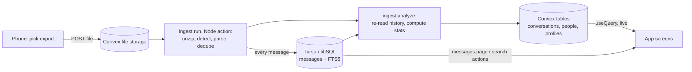

# @textrovert/history

The chat history data layer: parsers for 10 platforms, a Turso message store that keeps every message, the analyzer,
and the Convex backend that runs them. It is its own Convex project, separate from `packages/backend`.

Users upload the chat exports they already have (a zip or single file from WhatsApp, iMessage, Instagram, Messenger,
Snapchat, Discord, Telegram, ChatGPT, Claude, or a CSV). The backend detects what each file is, parses it into one
normalized shape, keeps **every** message, and turns the history into stats the app renders live.



## Where data lives

| What | Where | Why |
| --- | --- | --- |
| Raw upload | Convex file storage | Deleted as soon as processing ends (done or failed). |
| Every message | Turso (`pipeline/store.ts`): `messages` table + FTS5 index, partitioned by a hash of the owner key | Full history can be millions of rows; Convex's free tier caps the database at 0.5 GB. |
| Per-chat stats, people, profile insights, upload status | Convex (`convex/schema.ts`) | Small, reactive: screens update live while an upload is processed. |

The app never talks to Turso. Message pages and search go through Convex actions (`convex/messages.ts`), so the
Turso token stays on the server.

Messages get a deterministic id from (platform, chat, time, sender, text), so uploading the same export twice, or an
overlapping newer export, only adds the messages that are new. Stats are always recomputed from the stored history,
never from one upload alone.

## Using it from the app

`client/chatData.ts` has the client plumbing (copy it into the Expo app and point its `_generated` import at this
package; it needs `expo-document-picker`, `expo-file-system`, and `expo-secure-store`, all in Expo Go). Everything else
is regular Convex calls against this package's `convex/_generated/api`.

```ts
const { ownerKey } = useOwnerKey(); // per-device key, minted on first launch, kept in SecureStore
const convex = useConvex();

// Upload: opens the file picker, uploads each file, starts processing. Returns upload ids.
const uploadIds = await pickAndUploadExports(convex, ownerKey, { selfName: "Kevin" /* optional */ });

// Live progress: status is queued → parsing → analyzing → done | failed (with `error`).
const upload = useQuery(api.uploads.get, ownerKey ? { ownerKey, uploadId } : "skip");

// Wrapped-style profile stats (null until the first upload finishes).
const profile = useQuery(api.insights.get, ownerKey ? { ownerKey } : "skip");

// Chats and people, paginated. sort: "recent" | "messages" | "closeness"; optional platform filter.
const chats = usePaginatedQuery(api.conversations.list, ownerKey ? { ownerKey, sort: "closeness" } : "skip", { initialNumItems: 30 });
const people = usePaginatedQuery(api.people.list, ownerKey ? { ownerKey } : "skip", { initialNumItems: 30 });
const chat = useQuery(api.conversations.get, { ownerKey, conversationId }); // full stats for one chat
const person = useQuery(api.people.get, { ownerKey, personId }); // one person + their chats

// Full message history (actions, not live queries).
const { messages, nextCursor } = await convex.action(api.messages.page, { ownerKey, conversationId, cursor, limit: 50 });
const hits = await convex.action(api.messages.search, { ownerKey, query: "pizza" }); // snippet marks matches with **
const context = await convex.action(api.messages.around, { ownerKey, conversationId, messageId: hit.id, ts: hit.ts });

// Wipe everything (Turso rows, Convex rows, files).
await convex.action(api.account.deleteAllData, { ownerKey });
```

### What the stats contain

- **Profile insights** (`insights.get`): totals (sent, received, chats, people, first and last message), messages per
  platform, a 7×24 heatmap of when you text (index `weekday * 24 + hour`, Sunday = 0, in the phone's time zone),
  monthly sent/received, your vs. their reply-time medians and histograms, habits (who starts conversations, double
  texts, night-owl share, words per message, laughs, questions, emojis), top emojis and words, top people, archetype
  badges with a reason line ("Night Owl: 21% of your texts go out between midnight and 5am"), and AI usage (prompts,
  prompts per month).
- **Per chat** (`conversations.get` → `stats`): message counts, first/last message, active days, longest streak and
  gap, sessions, per-participant breakdown (messages, words, media, emojis, laughs, questions, who starts and who has
  the last word, double texts, reply-time medians), hourly/weekday/heatmap, monthly volume, top words and emojis,
  links, calls, and AI prompt stats for ChatGPT/Claude chats. `closeness` is a 0-100 score from volume, balance,
  recency, and consistency.
- **People** (`people.list`): everyone you talk to, merged across platforms by name, ranked by closeness.

### Who is "me"?

Exports often don't say which sender is the user. The pipeline works it out from profile files (Instagram,
Messenger, Telegram), chat titles (a WhatsApp DM is named after the other person), names learned from earlier
uploads, and the participant present in nearly every chat. A chat it can't resolve has `selfName: null`; pass
`selfName` when uploading (for example, ask "what's your name in your chats?") to settle it.

## Getting exports (what to tell users)

| App | How | Upload |
| --- | --- | --- |
| WhatsApp | Chat → ⋯ → Export chat → **Without media** | the .zip or .txt |
| Instagram | Accounts Center → Your information → Download → Messages only, **JSON** | the .zip |
| Messenger / Facebook | Same flow, Messages, **JSON** (end-to-end encrypted chats export separately as JSON) | the .zip |
| Telegram | Desktop app → Settings → Advanced → Export Telegram data, **JSON** | result.json or the zip |
| Snapchat | Settings → My Data → include Chat History, **JSON** | the .zip |
| Discord | Settings → Data & Privacy → Request data | the package .zip |
| ChatGPT | Settings → Data controls → Export | the .zip |
| Claude | Settings → Privacy → Export data | the .zip |
| iMessage | On a Mac: the Textrovert Mac app in `mac/` exports it with imessage-exporter and uploads it. Or copy `~/Library/Messages/chat.db` | done by the Mac app, or chat.db |
| Anything else | CSV with date, sender, and text columns | the .csv |

Several platforms can go in one zip, or be uploaded one after another; it all merges.

## Setup

```sh
pnpm install                 # from the repo root
cd packages/history
npx convex dev               # pick or create the Convex project; writes .env.local
```

This code is live on Kevin's dev deployment `wry-bandicoot-379` (project consumer-mobile-hack), which already has the
Turso variables set; use that project to keep the data. On a new deployment, the message store needs a Turso database
(a regular libSQL one, not the preview engine, in AWS us-east-1 next to Convex; the free tier holds 5 GB):

```sh
npx convex env set TURSO_DATABASE_URL libsql://<db>-<org>.turso.io
npx convex env set TURSO_AUTH_TOKEN <token>
```

Tables and the search index are created on first use. If the database has no FTS5 support, search falls back to
substring matching instead of failing.

Local development needs no Turso or Convex: `pnpm analyze ~/Downloads/export.zip --tz America/Los_Angeles`
runs the whole pipeline against a SQLite file in `.data/` and prints the insights (`--json` for the raw output,
`--me "Your Name"` to say who you are). `pnpm test` runs the parser, store, analyzer, and end-to-end tests; `pnpm typecheck` checks the pipeline and Convex code.

## Local Ask API (dev only)

`scripts/ask-server.ts` runs the assistant (`pipeline/assistant`) over a local message database so an app can try Ask
against real chats without Convex. It binds 127.0.0.1 only, sends CORS headers, and opens the database on one
connection with `busy_timeout` and `query_only`, so it never writes. Nothing about the data is hardcoded; it reads:

| Variable | Meaning |
| --- | --- |
| `ASK_DB` | Path to the libSQL/SQLite file (messages, chunks, episodes, facts). |
| `ASK_OWNER` | Store owner of the rows. |
| `ASK_CONVERSATIONS` | JSON array of `ConversationRef` (the chat directory the assistant scopes to). |
| `ASK_ENV_FILE` or `OPENAI_API_KEY` | A file containing `OPENAI_API_KEY=...`, or the key itself. |
| `ASK_TZ` | Owner's IANA time zone (defaults to this machine's). |
| `ASK_PORT`, `ASSISTANT_MODEL` | Optional: port (8787) and chat model override. |

```sh
ASK_DB=.data/my.db ASK_OWNER=local ASK_CONVERSATIONS=.data/my-refs.json ASK_ENV_FILE=../ingest/.env \
ASK_TZ=America/Los_Angeles pnpm ask-server
```

It exits with a message naming the missing variable or file. Endpoints (all dates are ISO 8601 strings):

- `GET /people` → `{"people": [{"name", "dm", "chats", "messages", "lastAt"}]}`, people with a DM first, by message count.
- `POST /ask` with `{"question", "person"?, "history"?: [{"role": "user" | "assistant", "content"}]}` →
  `{"answer", "person", "chats", "citations": [{"n", "messageId", "sender", "fromMe", "chat", "chatId", "sentAt", "text", "quote"}]}`.
  `answer` carries inline `[n]` markers; each citation's `text` is the full original message and `quote` the exact
  span the answer relies on. `person` scopes the assistant to the chats that person is in (their DM and shared groups).
  Errors are `{"error"}` with a 4xx/5xx status.
- `POST /wrapped` with `{"conversationId", "from": "YYYY-MM-DD", "through": "YYYY-MM-DD", "model"?: true,
  "avoiding"?: [messageId], "number"?, "includeWarmMoments"?, "allowAffectionateTeasing"?, "timeoutMs"?, "debug"?}` →
  `{"conversation", "range", "outcome", "model"}`: one Wrapped edition (`@textrovert/wrapped`) for a DM over whole days in
  `ASK_TZ`. Message ids are the store's ids and the owner's messages carry participant id `owner`. `outcome` is the
  package's `WrappedOutcome` as JSON (instants in epoch ms), with every quote already resolved against the rows; groups
  get `{"kind": "empty", "reason": {"kind": "unsupportedConversation"}}`. With `model` (default on) the eligible
  messages go to OpenAI (`WRAPPED_MODEL`, default gpt-5-mini) and its picks pass the same gate; `"model": false` is
  rules only. Pass the previous editions' source ids as `avoiding` for "Another edition".
- `GET /health` → `{"ok": true, "chats"}`.

## Limits

- A Convex upload must finish within 2 minutes, so exports should be text-only (no media).
- Measured on the dev deployment with Turso in us-east-1: a 30k-message export is done in about 15 seconds, and a
  260k-message export (WhatsApp, Instagram, Telegram, ChatGPT in one zip) in 91 seconds: 43 s to parse and store,
  45 s to analyze. Processing runs in Node actions (512 MB, 10 minutes per stage; analysis continues in a new action
  when it runs long), and the pipeline stays under 160 MB of heap at that size. An upload whose processing dies is
  marked failed by a watchdog instead of spinning forever.
- Attachments aren't stored, only the fact that a photo, video, voice note, sticker, or link was sent.
- People are merged across platforms by display name, so two different people with the same name are merged.
