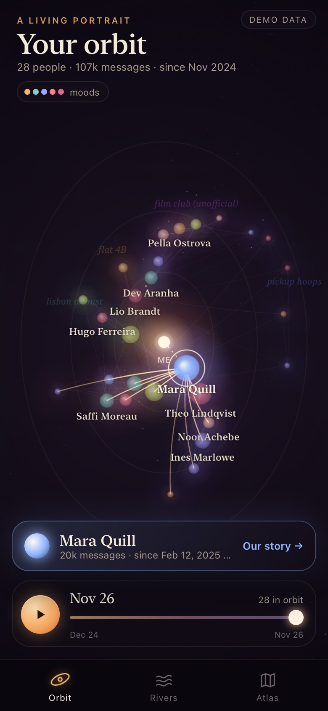

# @textrovert/portrait

A living portrait of your friendships, built from your chat history: a constellation of the people you talk to,
a memoir of each close friendship with tappable receipts, a streamgraph of who filled your weeks, and an atlas of
the topics you share. Mobile-first (390×844) for embedding in the iOS app through WKWebView, and it works on desktop.

## Run

```sh
pnpm --filter @textrovert/portrait dev        # http://localhost:5180
pnpm --filter @textrovert/portrait build-portrait
pnpm --filter @textrovert/portrait typecheck
```

The app loads `/portrait.json`, which the dev server serves from `.data/portrait.json` when it exists, and falls
back to the synthetic `fixtures/demo-portrait.json` otherwise. Add `?demo` to the URL to force the demo data.
Production builds never include `.data`.

Deep links: `#/orbit`, `#/rivers`, `#/atlas`, and `#/<view>/p/<personId>` for a person's story. When embedded,
taps post `"light"` or `"medium"` to `window.webkit.messageHandlers.haptic` if the native shell registers it.

## Data

`scripts/build-portrait.ts` reads the local libSQL database and conversation directory and writes
`.data/portrait.json` (ignored by git; it holds real messages). Inputs come from env:

| Variable | Default |
| --- | --- |
| `PORTRAIT_DB` | the local `packages/history/.data/ig.db` |
| `PORTRAIT_REFS` | the local `packages/history/.data/ig-refs.json` |
| `PORTRAIT_OWNER` | `local-ig` |
| `PORTRAIT_TZ` | `America/Los_Angeles` |
| `PORTRAIT_ENV` | `.env` file holding `OPENAI_API_KEY` (or set `OPENAI_API_KEY` directly) |
| `PORTRAIT_STORIES` | `15` memoirs |

Series are bucketed by week when the history spans under ~18 months and by month otherwise. Memoirs are written by
gpt-5-mini with a strict JSON schema; every footnote must point at a message in a conversation with that person, and
sentences with no valid footnote are dropped. A footnote on an episode's first message also pulls in that episode's
summary and the friend's fullest lines from it. Chapter periods come from the cited messages' dates, not the model.
LLM responses are cached in `.data/llm-cache`, so reruns cost nothing unless the inputs change.

`scripts/make-demo.ts` regenerates the synthetic fixture (invented people and messages only).


